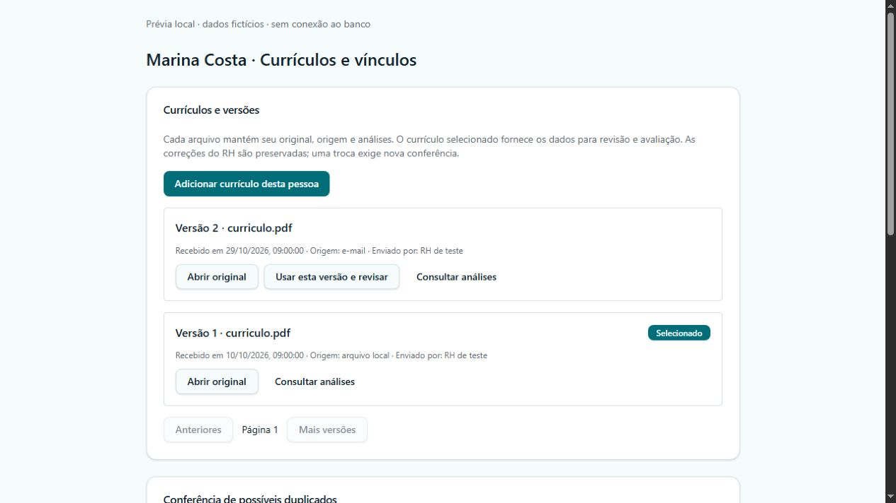
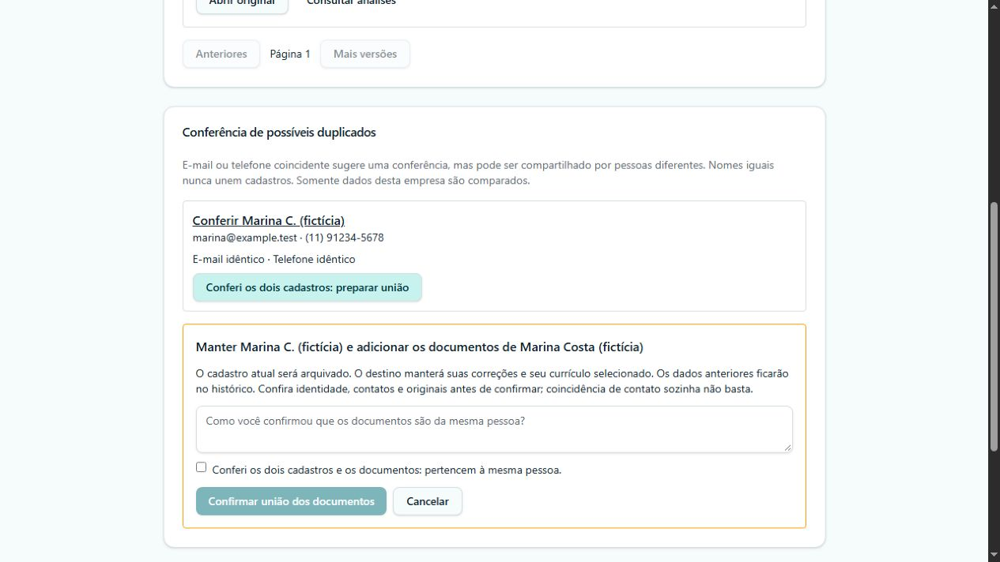
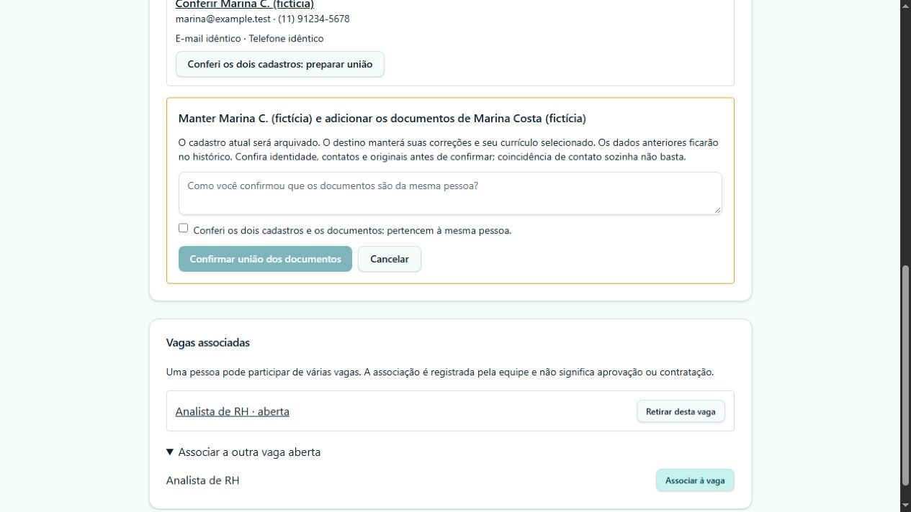

# Pessoas, documentos e acervo — 29/10/2026

Implementação na branch `ceny-versaonova`, banco novo `wikerxujjvmoksrmjywo`. A `main` permanece em `58df482099e187f25ef2c154789321df8b0b1815`.

## Comportamento entregue

- `candidates` representa a pessoa; `resume_documents` mantém vários originais por pessoa; `resume_jobs` e `resume_job_attempts` registram leituras e tentativas de cada documento.
- O conteúdo, caminho, nome recebido, tamanho, origem e autor do original são imutáveis. Versões antigas permanecem disponíveis sob as mesmas regras da empresa e do candidato.
- SHA-256 é calculado pelo serviço após a validação dos bytes. A unicidade por empresa reutiliza arquivos iguais com nomes diferentes; arquivos diferentes com o mesmo nome têm documentos e caminhos distintos. O leitor verifica novamente o hash antes de enviar conteúdo para análise.
- “Adicionar currículo desta pessoa” exige confirmação da identidade na tela e no recebimento. O último novo recebimento confirmado seleciona a versão e reabre a revisão. Um arquivo já existente em outro cadastro não é transferido automaticamente; a resposta aponta o cadastro original para conferência.
- A equipe pode selecionar um original anterior. A troca restaura sua extração, conserva as correções humanas e exige nova revisão. Apenas a análise do documento selecionado pode alterar os dados atuais ou o andamento da pessoa; falhas, cancelamentos e conclusões de outra versão ficam ligados àquela versão.
- E-mail normalizado ou telefone com pontuação removida sugerem possíveis duplicados dentro da empresa. Nome sozinho e ausência de contato não produzem correspondência. Contatos compartilhados continuam exigindo conferência humana.
- Somente administrador/responsável pode reunir cadastros, com justificativa e confirmação. Os dois números de revisão precisam corresponder aos conferidos. Envios ou leituras ativos bloqueiam a operação. Os documentos e trabalhos passam para o destino, sem alterar os caminhos. O destino conserva seus dados e correções; o cadastro de origem é arquivado, com dados e revisões preservados em auditoria. Não há união automática nem mecanismo automático de desfazer a união: conferir os originais é obrigatório.
- Vínculos explícitos com várias vagas usam chaves que incluem a empresa. Repetições não duplicam vínculos ou eventos. Retirar o vínculo mantém a pessoa no acervo. Vagas encerradas conservam seus vínculos; novos vínculos exigem vaga aberta.
- A página da vaga permite recuperar pessoas já cadastradas. O ranking considera toda a base autorizada e apresenta aderência, requisitos e evidências verificáveis. Associar à vaga continua sendo decisão explícita do RH. Uma avaliação não representa contratação nem previsão de desempenho.
- As buscas consultam os valores atuais, com paginação no banco. Correções, seleção de versão, arquivamento e união reabrem/sinalizam a revisão ou invalidam os resultados anteriores. O histórico de ranking é preservado e marcado como desatualizado; recalcular é uma ação explícita, e a associação por recomendação antiga fica desabilitada. Não há processamento de IA disparado apenas por pesquisar.

## Segurança e rastreabilidade

Migrações: `20261029090757_candidate_document_versions`, `20261029091638_document_version_integrity`, `20261029171451_document_private_commands`, `20261029172117_preserve_merged_job_history`.

Os comandos públicos de escrita delegam a implementações privadas que verificam identidade, empresa e função. As tabelas novas permitem apenas leitura autorizada ao cliente; escrita e histórico não podem ser fabricados pelo navegador. Links de originais validam empresa, candidato, documento e recebimento antes de assinar por 60 segundos. Arquivamento retira também o acesso aos originais de todas as versões. A limpeza de órfãos considera os caminhos de todos os documentos.

As seleções registram documento, ator e horário. As uniões preservam snapshots dos dois cadastros, correções anteriores, justificativa e ator, além dos documentos, vínculos e eventos anteriores. A transferência de identidade conserva também a participação em vagas encerradas. Vínculos com vagas possuem eventos de inclusão/retirada. O ranking registra qual documento estava selecionado, sua versão, hash e análise correspondente.

## Verificação

Validação completa aprovada no commit `d55bd5684322d16fa6eb5128a6ecdc6df07dfe26`: [execução 40920755697](https://github.com/vitorbaadorno/ceny.assist/actions/runs/40920755697). Inclui todos os testes SQL, 110 testes automatizados, 13 testes reais de recebimento/armazenamento com arquivos sintéticos, autenticação, revisão concorrente, vagas, ranking com 1.201 pessoas elegíveis e compilação. A execução anterior `40919779645` também foi aprovada.

- 110 testes automatizados locais aprovados, incluindo assinatura restrita ao documento e recusa de bytes substituídos com o mesmo tamanho.
- Verificação de tipos, compilação de produção e verificação dos dois serviços aprovadas.
- 41 testes específicos do banco executados em transação desfeita, sem registros persistentes: versões, hashes, seleção, conclusão de análise antiga, auditoria, união, conflitos, isolamento, vínculos múltiplos, preservação de vagas encerradas e busca além de 1.000 pessoas.
- Regressões remotas em transações desfeitas: 28 de recebimento, 37 de fila, 29 de revisão e 20 de rankings.
- Interface conferida com componentes reais e dados fictícios locais: seleção de versão anterior, confirmação bloqueada sem justificativa/aceite e associação explícita à vaga. As imagens abaixo são de uma prévia sem conexão ao banco.
- Serviços publicados: `ceny-worker` versão 13 e `ceny-queue` versão 4. Conferência de segurança sem novos avisos de exposição; permanece o aviso anterior de proteção contra senhas vazadas desativada, além das tabelas privadas intencionalmente sem políticas de acesso.

## Limites explícitos

Sem execução real de IA nesta etapa, conforme orientação do usuário. Os testes usam arquivos sintéticos e respostas controladas; não comprovam a precisão real da extração. A sugestão de duplicidade é conservadora: não tenta adivinhar identidade com nomes parecidos, telefones diferentes ou contatos ausentes. A tela mostra até 30 sugestões por contato e as 100 leituras mais recentes de cada documento; os registros anteriores permanecem no banco.

O histórico legado sem empresa confirmada continua em quarentena. A implantação encontrou zero candidatos e documentos no banco novo; não distribuiu registros antigos entre clientes.
