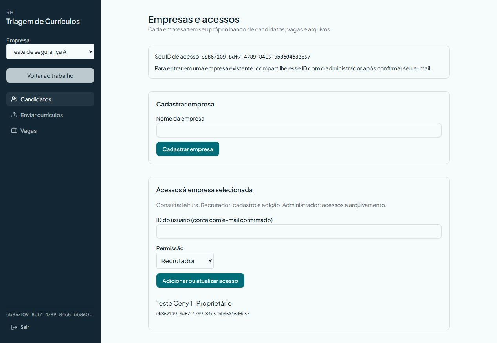

# Isolamento por empresa — validação

Ambiente autorizado: Supabase **Ceny Assist**, projeto `wikerxujjvmoksrmjywo`, conta nova conectada ao plugin. Conferência final em 24/10/2026. Esta evidência se refere ao novo ambiente; não certifica o antigo backend nem altera o site publicado na `main`.

## Implementação

- Cadastro de empresas e associação de usuários com papéis de proprietário, administrador, recrutador e consulta.
- `company_id` obrigatório em candidatos, vagas, pontuações/avaliações e relatórios. As observações pertencem ao candidato e seguem sua RLS.
- RLS em todas as tabelas públicas; clientes anônimos não recebem acesso às tabelas da aplicação. As decisões consultam associações no banco, sem confiar em `user_metadata` ou numa empresa enviada pelo navegador.
- Chaves estrangeiras compostas impedem vincular candidato, vaga ou relatório de empresas distintas, inclusive em gravações privilegiadas.
- Perfis minimizados (sem e-mail público): usuário vê o próprio perfil; proprietário/administrador vê perfis dos membros de sua empresa.
- Bucket `resumes` privado, caminho gerado pelo banco e vinculado ao candidato; não há política de substituição do arquivo original. Upload valida tipo e tamanho (PDF/JPG/PNG, até 10 MB).
- O handler de link verifica associação, candidato e empresa, e obtém o caminho do banco. O Storage aplica RLS novamente ao assinar/baixar.
- Arquivamento atômico exige proprietário/administrador e empresa correta. Pontuações e snapshots de relatórios são invalidados. Originais arquivados ficam fora das leituras autorizadas.
- Permissões por coluna bloqueiam mudanças diretas em resultados da IA e informações de processamento. Clientes não gravam pontuações nem relatórios.
- A Edge Function `ceny-worker` autentica com `auth.getUser`, valida o corpo com schema estrito e lê dados sob o JWT do usuário. A gravação privilegiada usa RPCs restritas ao servidor, que conferem novamente o ator e sua empresa. O ranking pagina candidatos e grava o conjunto em transação.
- Legado não confirmado permanece em schema e bucket de quarentena sem acesso de clientes.

## Testes executados

| Camada | Resultado |
|---|---|
| PostgreSQL real, transação com rollback | 55 verificações passaram |
| Handlers reais com fronteiras instrumentadas | 13 testes passaram |
| REST, Storage e Edge Function reais | 15 verificações passaram; ranking de 1 candidato da empresa correta |
| TypeScript | `bun run typecheck` passou |
| Build de produção | `bun run build` passou |
| Navegador | Login, administração, troca de empresa e papel de consulta conferidos |

Os testes cobrem acesso anônimo, usuário sem empresa, associação a múltiplas empresas, leitura cruzada, edição de observações, adulteração de IA/pontuações, mudança de empresa/caminho, associação candidato/vaga incompatível, alterações de membros, arquivamento, originais, revogação com JWT existente e quarentena. Os testes HTTP verificam também a função publicada, download e assinatura de arquivos, e tentativas de sobrescrever ou excluir arquivos alheios.

As duas contas, empresas, candidatos, vagas e arquivos temporários de integração foram removidos. A consulta final confirmou zero contas/empresas temporárias e zero objetos de currículo. Nenhum dado real foi usado nos testes.

Os arquivos de evidência nesta pasta incluem o resultado SQL, resultado HTTP e snapshot do catálogo remoto (RLS, políticas, grants e hashes de funções). As migrations locais correspondem às versões registradas no remoto. Reexecutar a consulta de catálogo e comparar os resultados permite detectar alterações posteriores. A verificação é pontual, não monitoramento contínuo.

O advisor de segurança apontou apenas a informação `rls_enabled_no_policy` em `private.legacy_records`: ausência intencional de políticas de cliente, para manter a quarentena fechada. [Explicação do advisor](https://supabase.com/docs/guides/database/database-linter?lint=0008_rls_enabled_no_policy). Os índices das referências da quarentena foram adicionados após a análise de desempenho.

## Limites e pendências reais

- Não foi fornecida a chave de IA. A extração está implementada, mas sua chamada ao provedor não foi validada. Configure `LOVABLE_API_KEY` nos secrets da Edge Function antes de usar a extração.
- Não foram fornecidos dados antigos nem comprovações da empresa de cada registro. Eles não foram importados ou distribuídos. Ver `legado.md`.
- A versão nova do frontend está na branch órfã; o site antigo publicado não foi substituído. OAuth Google, credenciais do autocomplete de cidades e redirecionamentos do domínio precisam de configuração no ambiente escolhido para publicação.
- Arquivamento mantém dados para revisão administrativa; não é exclusão física. Links assinados já emitidos permanecem válidos até expirar. O handler usa 60 segundos; o endpoint de Storage permite que um cliente já autorizado escolha outro prazo ao assinar diretamente.
- Os testes não constituem auditoria externa de conformidade. Administradores do banco e credenciais de serviço são fronteiras de confiança e podem contornar RLS; essas credenciais ficam no ambiente do servidor.
- O build preserva avisos de depreciação do projeto original (`inputValidator` e `vite-tsconfig-paths`), sem erros de compilação.

